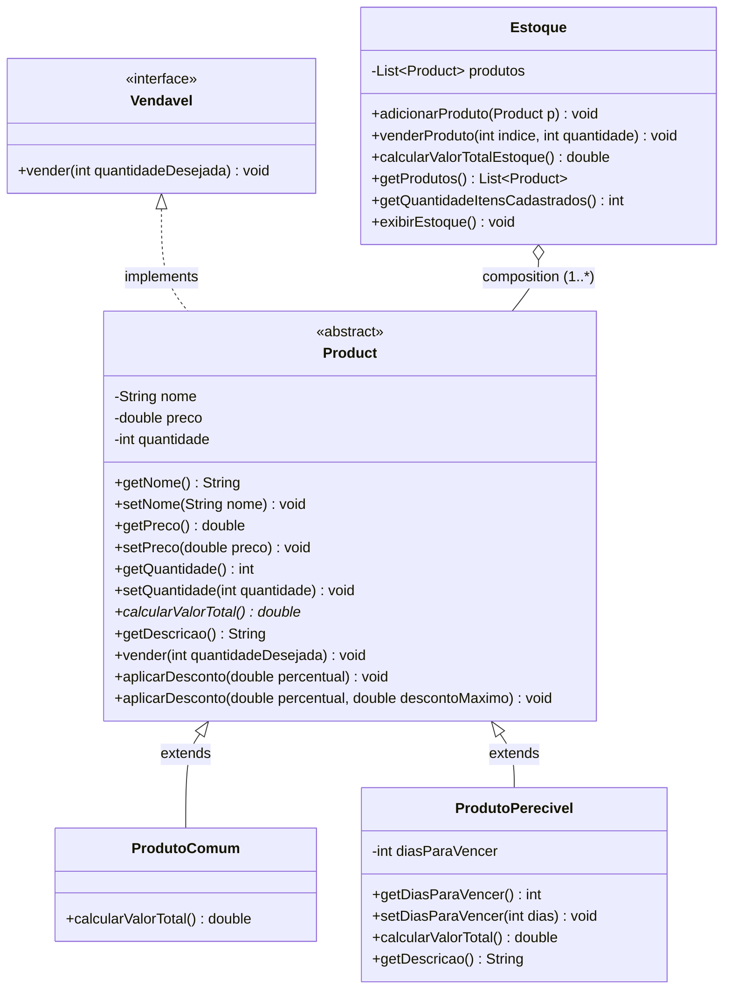
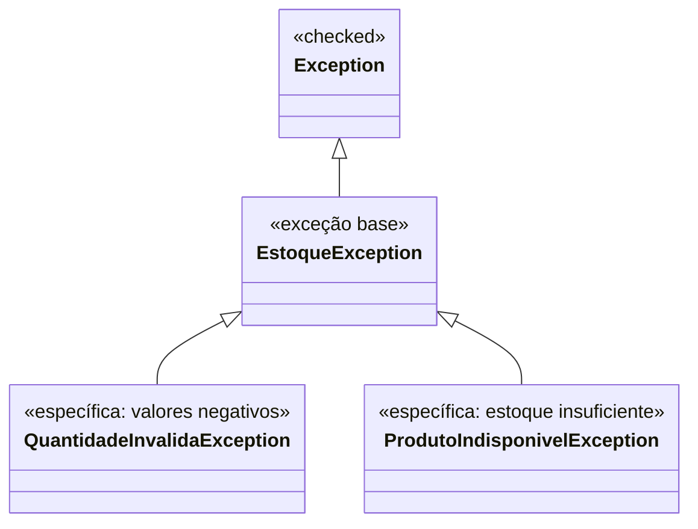

<div align="center">

# 📦 Sistema de Gerenciamento de Estoque

**Uma aplicação em Java orientada a objetos demonstrando arquitetura limpa, polimorfismo e tratamento robusto de exceções.**

[](https://www.oracle.com/java/)
[](https://pt.wikipedia.org/wiki/Programa%C3%A7%C3%A3o_orientada_a_objetos)
[](#)
[](#)

---

[Sobre o Projeto](#-sobre-o-projeto) •
[Pilares de POO](#-conceitos-de-poo-aplicados) •
[Diagrama UML](#-diagrama-de-classes-uml) •
[Estrutura](#-estrutura-do-projeto) •
[Como Executar](#-como-executar) •
[Demonstração](#-demonstração-da-execução) •
[Autor](#-autor)

---

</div>

## 📌 Sobre o Projeto

O **Sistema de Estoque** é um projeto desenvolvido para consolidar e demonstrar, de forma prática e aprofundada, os principais pilares da **Programação Orientada a Objetos (POO)** em Java.

O software simula operações de gerenciamento de itens, cálculo polimórfico de valores em estoque, venda com validação de disponibilidade, políticas de desconto sobrecarregadas e uma hierarquia customizada de tratamento de exceções.

### 🌟 Destaques do Sistema
- **Catálogo Misto**: Suporte a produtos convencionais e produtos perecíveis com regras de expiração.
- **Desconto Inteligente por Validade**: Produtos perecíveis a 3 dias ou menos do vencimento recebem **20% de desconto automático** no subtotal.
- **Sobrecarga de Métodos**: Flexibilidade para aplicar descontos percentuais diretos ou com limite monetário (teto máximo).
- **Tratamento Resiliente**: Prevenção de estados inconsistentes (preço negativo, estoque insuficiente ou negativo) através de exceções checadas personalizadas.

---

## 🧠 Conceitos de POO Aplicados

| Conceito | Onde é aplicado | Descrição |
| :--- | :--- | :--- |
| **Encapsulamento** | `Product`, `ProdutoPerecivel` | Atributos privados protegidos por getters e setters com validações de regras de negócio. |
| **Abstração** | `Product` | Classe abstrata que serve de modelo base, definindo o contrato obrigatório `calcularValorTotal()`. |
| **Interfaces** | `Vendavel` | Define o contrato de comercialização (`vender(int quantidade)`). |
| **Herança** | `ProdutoComum`, `ProdutoPerecivel` | Subclasses especializadas que reutilizam e estendem os atributos e comportamentos de `Product`. |
| **Polimorfismo Dinâmico** | `calcularValorTotal()`, `getDescricao()` | Sobrescrita de métodos onde cada tipo de produto calcula seu valor conforme sua especificidade (regra de validade). |
| **Polimorfismo Estático** | `aplicarDesconto(...)` | Sobrecarga de método na classe `Product` com assinaturas diferentes para cálculos com e sem teto máximo. |
| **Composição** | `Estoque` | Relação de *"Tem-um"* (`List<Product>`), promovendo baixo acoplamento e flexibilidade. |
| **Hierarquia de Exceções** | `EstoqueException` e filhas | Criação de exceções de domínio e demonstração prática da ordem mandatória de blocos `catch`. |

> [!IMPORTANT]
> **Hierarquia de Tratamento de Exceções (Catch Order):**
> No Java, blocos `catch` mais específicos (`QuantidadeInvalidaException`, `ProdutoIndisponivelException`) devem obrigatoriamente preceder a exceção genérica (`EstoqueException`). Inverter essa ordem gera erro de compilação por código inalcançável (*unreachable code*).

---

## 🏗️ Diagrama de Classes (UML)



### Hierarquia de Exceções de Domínio



---

## 📁 Estrutura do Projeto

```text
sistema-estoque/
├── .gitignore
├── README.md
└── src/
    ├── EstoqueException.java             # Exceção base de domínio (checked)
    ├── QuantidadeInvalidaException.java  # Exceção para quantidades/preços negativos
    ├── ProdutoIndisponivelException.java # Exceção para venda com saldo insuficiente
    ├── Vendavel.java                     # Interface de contrato para itens vendáveis
    ├── Product.java                      # Classe abstrata base com encapsulamento e sobrecargas
    ├── ProdutoComum.java                 # Subclasse comum com cálculo direto de valor
    ├── ProdutoPerecivel.java             # Subclasse perecível (desconto de 20% se validade <= 3)
    ├── Estoque.java                      # Composição do acervo e operações em lote
    └── EstoqueApp.java                   # Classe executável com cenários e testes demonstrativos
```

---

## 🚀 Como Executar

### Pré-requisitos
- **Java JDK 11+** (JDK 17 ou 21 recomendados)
- **Git** instalado no terminal

### 1. Clonar o Repositório
```bash
git clone https://github.com/JonnathanVituriano/Sistema-Estoque.git
cd Sistema-Estoque/src
```

### 2. Compilar os Arquivos Java
```bash
javac *.java
```

### 3. Executar o Programa
```bash
java EstoqueApp
```

---

## 🖥️ Demonstração da Execução

Ao rodar a aplicação `EstoqueApp`, todos os cenários são exercitados e validados no console:

```text
========================================================================
             SISTEMA DE GERENCIAMENTO DE ESTOQUE DE PRODUTOS            
========================================================================

>>> 1. CADASTRO DE PRODUTOS VÁLIDOS
✓ 4 produtos cadastrados com sucesso!

>>> ESTOQUE INICIAL:
-------------------------------------------------------------------------------------------------------
Item | Produto            | Preço Unitário   | Quantidade   | Validade/Info        | Subtotal      
-------------------------------------------------------------------------------------------------------
[ 0] | Teclado Mecânico   | R$        250,00 |         10 unid | -                    | R$     2500,00
[ 1] | Mouse Gamer        | R$        120,00 |         15 unid | -                    | R$     1800,00
[ 2] | Café Especial 500g | R$         35,00 |         20 unid | 30 dia(s)            | R$      700,00
[ 3] | Leite Integral 1L  | R$          5,00 |         50 unid | 2 dia(s) (20% OFF)   | R$      200,00
-------------------------------------------------------------------------------------------------------
VALOR TOTAL DO ESTOQUE: R$ 5200,00
-------------------------------------------------------------------------------------------------------

>>> 2. TESTE DE VALIDAÇÃO: CADASTRO COM QUANTIDADE NEGATIVA
Tentando instanciar ProdutoComum com quantidade = -5...
✓ Exceção esperada capturada com sucesso!
  [QuantidadeInvalidaException]: A quantidade não pode ser negativa: -5

>>> 3. DEMONSTRAÇÃO DE SOBRECARGA (aplicarDesconto)
Antes dos descontos:
  Produto: Teclado Mecânico   | Preço Unitário: R$  250,00 | Estoque:  10 unid.
  Produto: Mouse Gamer        | Preço Unitário: R$  120,00 | Estoque:  15 unid.

Após aplicarDesconto(10.0%) no Teclado:
  Produto: Teclado Mecânico   | Preço Unitário: R$  225,00 | Estoque:  10 unid.

Após aplicarDesconto(50.0%, max R$ 20.00) no Mouse:
  Produto: Mouse Gamer        | Preço Unitário: R$  100,00 | Estoque:  15 unid.

>>> 4. TESTE DE VENDA BEM-SUCEDIDA
Vendendo 3 unidades do Teclado Mecânico (índice 0)...
✓ Venda realizada com sucesso!
  Estoque atualizado: Produto: Teclado Mecânico   | Preço Unitário: R$  225,00 | Estoque:   7 unid.

>>> 5. TESTE DE VENDA COM ESTOQUE INSUFICIENTE
Tentando vender 15 unidades do Teclado Mecânico (disponível: 7)...
✓ Exceção esperada capturada com sucesso!
  [ProdutoIndisponivelException]: Estoque insuficiente para 'Teclado Mecânico'. Solicitado: 15, Disponível: 7

>>> 6. DEMONSTRAÇÃO DA HIERARQUIA DE CATCHES (Bloco Unificado)
Executando operação controlada com múltiplos riscos de exceção:
Testando operação (índice: 0, quantidade: -2)...
  -> [CATCH ESPECÍFICO 1 - QuantidadeInvalidaException]: A quantidade solicitada deve ser maior que zero: -2
Testando operação (índice: 0, quantidade: 50)...
  -> [CATCH ESPECÍFICO 2 - ProdutoIndisponivelException]: Estoque insuficiente para 'Teclado Mecânico'. Solicitado: 50, Disponível: 7
Testando operação (índice: 99, quantidade: 1)...
  -> [CATCH GENÉRICO 3 - EstoqueException]: Falha operacional: índice de produto fora do estoque (99)

>>> 7. RELATÓRIO FINAL DO ESTOQUE E POLIMORFISMO DINÂMICO
Observação sobre o cálculo polimórfico:
 - Produtos comuns: Preço Unitário * Quantidade
 - Leite Integral (validade = 2 dias <= 3): Preço Unitário * Quantidade com 20% de desconto automático.

-------------------------------------------------------------------------------------------------------
Item | Produto            | Preço Unitário   | Quantidade   | Validade/Info        | Subtotal      
-------------------------------------------------------------------------------------------------------
[ 0] | Teclado Mecânico   | R$        225,00 |          7 unid | -                    | R$     1575,00
[ 1] | Mouse Gamer        | R$        100,00 |         15 unid | -                    | R$     1500,00
[ 2] | Café Especial 500g | R$         35,00 |         20 unid | 30 dia(s)            | R$      700,00
[ 3] | Leite Integral 1L  | R$          5,00 |         50 unid | 2 dia(s) (20% OFF)   | R$      200,00
-------------------------------------------------------------------------------------------------------
VALOR TOTAL DO ESTOQUE: R$ 3975,00
-------------------------------------------------------------------------------------------------------
========================================================================
                     EXECUÇÃO CONCLUÍDA COM SUCESSO!                    
========================================================================
```

---

## 👨‍💻 Autor

Desenvolvido por **Jonnathan Vituriano**.

[](https://github.com/JonnathanVituriano)